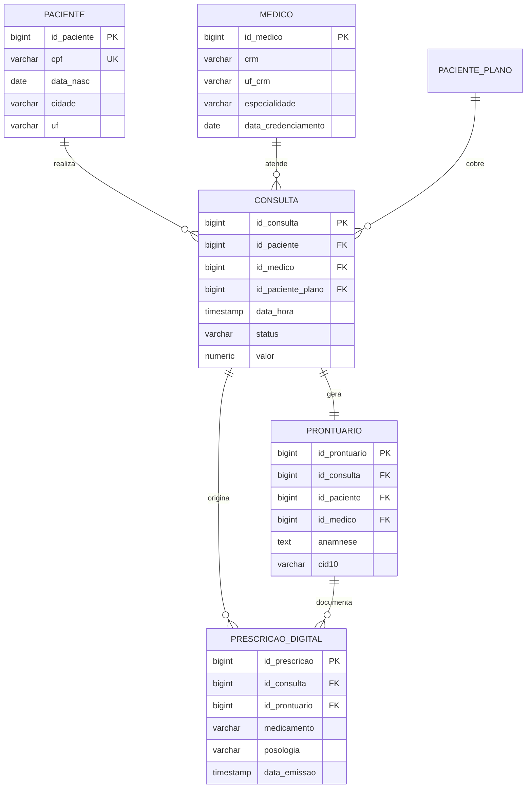
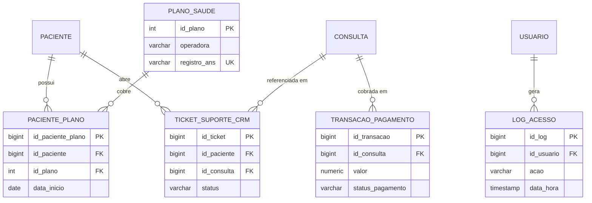
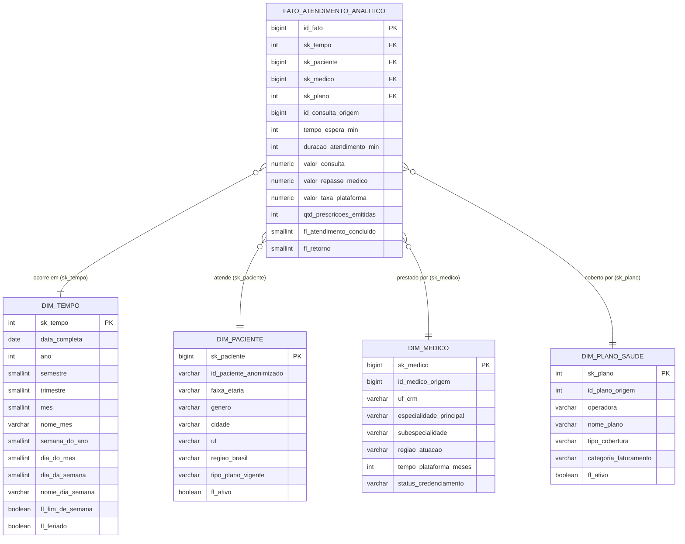

# Entrega 2 — Data Modeling (Visão Estrutural / Detalhada)

## 2.A Modelagem Lógica OLTP (Entidades Clínicas e Usuários)

_Responsável: Hudnei Sued Passos Santana_

Esta seção modela o **núcleo clínico e assistencial** do modelo operacional (PostgreSQL), focado no atendimento e no perfil dos usuários: pacientes, médicos, consultas, prontuário eletrônico e prescrições digitais. Elas formam a **Parte 1**, a qual as entidades operacionais e de suporte (Parte 2) referenciam por chaves estrangeiras.

### 2.A.1 Entidades

| Entidade             | Papel no sistema                                                                     |
| -------------------- | ------------------------------------------------------------------------------------ |
| `PACIENTE`           | Cadastro e identificação do titular de saúde, base do PEP                            |
| `MEDICO`             | Corpo clínico credenciado (CRM, especialidades e credenciamento)                     |
| `CONSULTA`           | Agendamento, controle de status e sessão de telemedicina                             |
| `PRONTUARIO`         | Registro clínico do atendimento (anamnese, diagnóstico, conduta)                     |
| `PRESCRICAO_DIGITAL` | Receituário eletrônico assinado com certificado ICP-Brasil (1 linha por medicamento) |

### 2.A.2 Dicionário de dados

#### PACIENTE

| Atributo      | Tipo (PostgreSQL) | Restrições              | Descrição                         |
| ------------- | ----------------- | ----------------------- | --------------------------------- |
| id_paciente   | BIGSERIAL         | PK                      | Identificador único do paciente   |
| nome_completo | VARCHAR(150)      | NOT NULL                | Nome completo do titular          |
| cpf           | VARCHAR(11)       | NOT NULL, UNIQUE        | CPF sem máscara (somente dígitos) |
| data_nasc     | DATE              | NOT NULL                | Data de nascimento                |
| genero        | VARCHAR(20)       | NOT NULL                | Gênero declarado pelo paciente    |
| telefone      | VARCHAR(20)       | NULL                    | Telefone para contato             |
| email         | VARCHAR(150)      | NULL                    | E-mail do paciente                |
| cidade        | VARCHAR(100)      | NOT NULL                | Município de residência           |
| uf            | VARCHAR(2)        | NOT NULL                | Unidade Federativa (UF)           |
| data_cadastro | TIMESTAMP         | NOT NULL, DEFAULT now() | Data/hora do cadastro             |
| fl_ativo      | BOOLEAN           | NOT NULL, DEFAULT TRUE  | Vínculo cadastral ativo           |

> **LGPD:** dados cadastrais e dados clínicos são segregados — informações clínicas ficam exclusivamente em `PRONTUARIO`, não em `PACIENTE`.

#### MEDICO

| Atributo              | Tipo (PostgreSQL) | Restrições                                        | Descrição                                  |
| --------------------- | ----------------- | ------------------------------------------------- | ------------------------------------------ |
| id_medico             | BIGSERIAL         | PK                                                | Identificador do profissional              |
| nome_completo         | VARCHAR(150)      | NOT NULL                                          | Nome completo do médico                    |
| crm                   | VARCHAR(15)       | NOT NULL                                          | Número do registro no CRM                  |
| uf_crm                | VARCHAR(2)        | NOT NULL                                          | UF de emissão do CRM                       |
| especialidade         | VARCHAR(100)      | NOT NULL                                          | Especialidade principal (ex.: Cardiologia) |
| subespecialidade      | VARCHAR(100)      | NULL                                              | Subespecialidade, se houver                |
| regiao_atuacao        | VARCHAR(50)       | NOT NULL                                          | Região de atuação credenciada              |
| data_credenciamento   | DATE              | NOT NULL                                          | Data de credenciamento na plataforma       |
| status_credenciamento | VARCHAR(20)       | NOT NULL, CHECK IN ('ATIVO','SUSPENSO','INATIVO') | Situação cadastral                         |

> Restrição única sugerida: (`crm`, `uf_crm`).

#### CONSULTA

| Atributo          | Tipo (PostgreSQL) | Restrições                                                                       | Descrição                                       |
| ----------------- | ----------------- | -------------------------------------------------------------------------------- | ----------------------------------------------- |
| id_consulta       | BIGSERIAL         | PK                                                                               | Identificador da consulta                       |
| id_paciente       | BIGINT            | FK -> PACIENTE, NOT NULL                                                         | Paciente atendido                               |
| id_medico         | BIGINT            | FK -> MEDICO, NOT NULL                                                           | Médico responsável                              |
| id_paciente_plano | BIGINT            | FK -> PACIENTE_PLANO (Parte 2), NULL                                             | Convênio utilizado (NULL = particular)          |
| data_hora         | TIMESTAMP         | NOT NULL                                                                         | Data/hora agendada do atendimento               |
| data_hora_inicio  | TIMESTAMP         | NULL                                                                             | Início efetivo do atendimento                   |
| data_hora_fim     | TIMESTAMP         | NULL                                                                             | Término efetivo do atendimento                  |
| status            | VARCHAR(20)       | NOT NULL, CHECK IN ('AGENDADA','EM_ANDAMENTO','CONCLUIDA','CANCELADA','NO_SHOW') | Situação da consulta                            |
| valor             | NUMERIC(10,2)     | NOT NULL, CHECK (valor >= 0)                                                     | Preço da consulta (cobrança efetiva na Parte 2) |
| tipo_atendimento  | VARCHAR(20)       | NOT NULL, CHECK IN ('TELEMEDICINA','PRESENCIAL')                                 | Modalidade do atendimento                       |
| data_criacao      | TIMESTAMP         | NOT NULL, DEFAULT now()                                                          | Momento do agendamento                          |

#### PRONTUARIO

| Atributo          | Tipo (PostgreSQL) | Restrições                       | Descrição                                |
| ----------------- | ----------------- | -------------------------------- | ---------------------------------------- |
| id_prontuario     | BIGSERIAL         | PK                               | Identificador do registro clínico        |
| id_consulta       | BIGINT            | FK -> CONSULTA, NOT NULL, UNIQUE | Consulta que gerou o registro (1:1)      |
| id_paciente       | BIGINT            | FK -> PACIENTE, NOT NULL         | Paciente titular (para RBAC e auditoria) |
| id_medico         | BIGINT            | FK -> MEDICO, NOT NULL           | Responsável pelo registro                |
| queixa_principal  | VARCHAR(300)      | NOT NULL                         | Motivo relatado pelo paciente            |
| anamnese          | TEXT              | NOT NULL                         | Entrevista clínica e sinais/sintomas     |
| historico_clinico | TEXT              | NULL                             | Histórico relevante do paciente          |
| diagnostico       | VARCHAR(300)      | NULL                             | Hipótese ou diagnóstico final            |
| cid10             | VARCHAR(10)       | NULL                             | Código CID-10 do diagnóstico             |
| conduta           | VARCHAR(500)      | NULL                             | Conduta médica adotada                   |
| observacoes       | TEXT              | NULL                             | Observações complementares               |
| data_registro     | TIMESTAMP         | NOT NULL, DEFAULT now()          | Momento do registro                      |

> `id_paciente` é tecnicamente derivável via `CONSULTA`, mas foi mantido deliberadamente para garantir controle de acesso (RBAC) e rastreabilidade sem joins adicionais, respeitando o critério de segurança do PEP.

#### PRESCRICAO_DIGITAL

| Atributo           | Tipo (PostgreSQL) | Restrições                                                        | Descrição                                |
| ------------------ | ----------------- | ----------------------------------------------------------------- | ---------------------------------------- |
| id_prescricao      | BIGSERIAL         | PK                                                                | Identificador do item de prescrição      |
| id_consulta        | BIGINT            | FK -> CONSULTA, NOT NULL                                          | Consulta de origem                       |
| id_prontuario      | BIGINT            | FK -> PRONTUARIO, NOT NULL                                        | Registro clínico vinculado               |
| medicamento        | VARCHAR(200)      | NOT NULL                                                          | Medicamento prescrito                    |
| posologia          | VARCHAR(200)      | NOT NULL                                                          | Dose, frequência e duração               |
| via_administracao  | VARCHAR(50)       | NULL                                                              | Via de administração (ex.: oral)         |
| data_emissao       | TIMESTAMP         | NOT NULL, DEFAULT now()                                           | Emissão da receita                       |
| validade_dias      | INT               | NOT NULL, DEFAULT 10                                              | Prazo de validade da receita             |
| assinatura_digital | VARCHAR(64)       | NULL                                                              | Hash/referência da assinatura ICP-Brasil |
| status             | VARCHAR(20)       | NOT NULL, CHECK IN ('RASCUNHO','ASSINADA','ENTREGUE','CANCELADA') | Situação do documento                    |

> Cada linha corresponde a **um medicamento**; uma receita assinada com N medicamentos gera N linhas compartilhando o mesmo documento (`id_consulta` + `assinatura_digital`).

### 2.A.3 Diagrama Entidade-Relacionamento

### 2.A.4 Cardinalidades e regras de negócio

| Relacionamento                  | Cardinalidade    | Regra                                                                |
| ------------------------------- | ---------------- | -------------------------------------------------------------------- |
| PACIENTE - CONSULTA             | 1 : N            | Um paciente pode realizar várias consultas ao longo do tempo         |
| MEDICO - CONSULTA               | 1 : N            | Um médico atende várias consultas                                    |
| CONSULTA - PRONTUARIO           | 1 : 1            | Toda consulta concluída gera exatamente um registro de prontuário    |
| CONSULTA - PRESCRICAO_DIGITAL   | 1 : N (0..N)     | A consulta pode ou não gerar prescrições                             |
| PRONTUARIO - PRESCRICAO_DIGITAL | 1 : N            | Um registro pode conter vários itens de medicamento                  |
| PACIENTE_PLANO - CONSULTA       | 1 : N (opcional) | Consulta sem convênio fica com `id_paciente_plano` NULL (particular) |

- **Prontuário:** só pode ser registrado após o início do atendimento (consulta com status diferente de `AGENDADA`); seu conteúdo é imutável e auditável.
- **Prescrição:** exige prontuário registrado (`id_prontuario` NOT NULL) e assinatura digital ICP-Brasil para validação.
- **Financeiro:** `CONSULTA.valor` é o **preço** da consulta; o valor efetivamente cobrado é tratado em `TRANSACAO_PAGAMENTO` (Parte 2).

### 2.A.5 Consistência e integração

- **Sem duplicação:** `PACIENTE` guarda dados cadastrais; `PRONTUARIO` guarda dados clínicos. Há segregação funcional e de acesso (LGPD).
- **Normalização:** atributos atômicos (1FN) e sem dependências parciais/transitivas (2FN/3FN); a única redundância proposital é `PRONTUARIO.id_paciente`, justificada por RBAC e auditoria.
- **Integração com o DW (OLAP):** `CONSULTA` alimenta `FATO_ATENDIMENTO_ANALITICO`; `PACIENTE` compõe `DIM_PACIENTE`; `MEDICO` compõe `DIM_MEDICO`; `PRESCRICAO_DIGITAL` fornece `qtd_prescricoes_emitidas`.
- **Dependências com a Parte 2:** `CONSULTA.id_paciente_plano` referencia `PACIENTE_PLANO`. A entidade `USUARIO` (exigida por `LOG_ACESSO` e citada em `MEDICO.id_usuario` na Parte 2) permanece como pendência a definir com Joalisson.

---

## 2.A Modelagem Lógica OLTP - Entidades Operacionais e de Suporte

_Responsável: Joalisson Pinto Maia_

Esta seção modela as entidades de **cobertura de saúde, financeiro, suporte ao paciente e auditoria** do modelo operacional (PostgreSQL). Elas complementam o núcleo clínico e de usuários (Parte 1), referenciando-o por chaves estrangeiras.

### 2.A.1 Entidades

| Entidade              | Papel no sistema                                          | Depende de (Parte 1)   |
| --------------------- | --------------------------------------------------------- | ---------------------- |
| `PLANO_SAUDE`         | Catálogo de planos/operadoras aceitos                     | -                      |
| `PACIENTE_PLANO`      | Vínculo entre paciente e plano, com histórico de vigência | `PACIENTE`             |
| `TRANSACAO_PAGAMENTO` | Cobrança financeira de uma consulta                       | `CONSULTA`             |
| `TICKET_SUPORTE_CRM`  | Chamado de suporte e relacionamento                       | `PACIENTE`, `CONSULTA` |
| `LOG_ACESSO`          | Trilha de auditoria de acessos e ações                    | `USUARIO`              |

### 2.A.2 Dicionário de dados

#### PLANO_SAUDE

| Atributo       | Tipo (PostgreSQL) | Restrições             | Descrição                               |
| -------------- | ----------------- | ---------------------- | --------------------------------------- |
| id_plano       | SERIAL            | PK                     | Identificador do plano                  |
| operadora      | VARCHAR(100)      | NOT NULL               | Nome da operadora                       |
| nome_plano     | VARCHAR(100)      | NOT NULL               | Nome comercial do plano                 |
| tipo_cobertura | VARCHAR(30)       | NOT NULL               | Ex.: ambulatorial, hospitalar, completo |
| registro_ans   | VARCHAR(20)       | UNIQUE                 | Registro na ANS                         |
| ativo          | BOOLEAN           | NOT NULL, DEFAULT TRUE | Plano aceito atualmente                 |

#### PACIENTE_PLANO

| Atributo           | Tipo        | Restrições                  | Descrição                        |
| ------------------ | ----------- | --------------------------- | -------------------------------- |
| id_paciente_plano  | BIGSERIAL   | PK                          | Identificador do vínculo         |
| id_paciente        | BIGINT      | FK -> PACIENTE, NOT NULL    | Paciente titular                 |
| id_plano           | INT         | FK -> PLANO_SAUDE, NOT NULL | Plano contratado                 |
| numero_carteirinha | VARCHAR(30) | NOT NULL                    | Número da carteirinha            |
| data_inicio        | DATE        | NOT NULL                    | Início da vigência               |
| data_fim           | DATE        | NULL                        | Fim da vigência (NULL = vigente) |

> Restrição única sugerida: (`id_paciente`, `id_plano`, `data_inicio`).

#### TRANSACAO_PAGAMENTO

| Atributo         | Tipo          | Restrições                                                                      | Descrição                                  |
| ---------------- | ------------- | ------------------------------------------------------------------------------- | ------------------------------------------ |
| id_transacao     | BIGSERIAL     | PK                                                                              | Identificador da transação                 |
| id_consulta      | BIGINT        | FK -> CONSULTA, NOT NULL                                                        | Consulta cobrada                           |
| valor            | NUMERIC(10,2) | NOT NULL, CHECK (valor >= 0)                                                    | Valor efetivamente cobrado                 |
| metodo           | VARCHAR(20)   | NOT NULL, CHECK IN ('PIX','CARTAO_CREDITO','CARTAO_DEBITO','BOLETO','CONVENIO') | Forma de pagamento                         |
| status_pagamento | VARCHAR(20)   | NOT NULL, CHECK IN ('PENDENTE','APROVADO','RECUSADO','ESTORNADO')               | Situação                                   |
| data_transacao   | TIMESTAMP     | NOT NULL, DEFAULT now()                                                         | Momento da cobrança                        |
| codigo_gateway   | VARCHAR(60)   | NULL                                                                            | Referência da transação no gateway externo |

> **LGPD/segurança:** dados de cartão **não** são armazenados; guarda-se apenas a referência devolvida pelo gateway de pagamento.

#### TICKET_SUPORTE_CRM

| Atributo        | Tipo        | Restrições                                                           | Descrição                                    |
| --------------- | ----------- | -------------------------------------------------------------------- | -------------------------------------------- |
| id_ticket       | BIGSERIAL   | PK                                                                   | Identificador do chamado                     |
| id_paciente     | BIGINT      | FK -> PACIENTE, NOT NULL                                             | Paciente solicitante                         |
| id_consulta     | BIGINT      | FK -> CONSULTA, NULL                                                 | Consulta relacionada (opcional)              |
| categoria       | VARCHAR(30) | NOT NULL                                                             | Ex.: pagamento, agendamento, acesso, técnico |
| prioridade      | VARCHAR(10) | NOT NULL, CHECK IN ('BAIXA','MEDIA','ALTA')                          | Urgência                                     |
| status          | VARCHAR(20) | NOT NULL, CHECK IN ('ABERTO','EM_ATENDIMENTO','RESOLVIDO','FECHADO') | Situação                                     |
| descricao       | TEXT        | NOT NULL                                                             | Relato do problema                           |
| data_abertura   | TIMESTAMP   | NOT NULL, DEFAULT now()                                              | Abertura                                     |
| data_fechamento | TIMESTAMP   | NULL                                                                 | Encerramento                                 |

#### LOG_ACESSO

| Atributo    | Tipo        | Restrições                                      | Descrição                                          |
| ----------- | ----------- | ----------------------------------------------- | -------------------------------------------------- |
| id_log      | BIGSERIAL   | PK                                              | Identificador do registro                          |
| id_usuario  | BIGINT      | FK -> USUARIO, NULL                             | Usuário (NULL em login com e-mail inexistente)     |
| acao        | VARCHAR(30) | NOT NULL                                        | Ex.: LOGIN, LOGOUT, LEITURA, ALTERACAO, EXPORTACAO |
| recurso     | VARCHAR(50) | NOT NULL                                        | Entidade acessada (ex.: PRONTUARIO)                |
| id_registro | BIGINT      | NULL                                            | Registro específico acessado                       |
| resultado   | VARCHAR(10) | NOT NULL, CHECK IN ('SUCESSO','FALHA','NEGADO') | Desfecho                                           |
| ip_origem   | INET        | NOT NULL                                        | IP da requisição                                   |
| data_hora   | TIMESTAMP   | NOT NULL, DEFAULT now()                         | Momento do evento                                  |

> O `LOG_ACESSO` sustenta a rastreabilidade exigida pela LGPD para dados sensíveis de saúde. É uma tabela _append-only_ (sem UPDATE/DELETE).

### 2.A.3 Diagrama Entidade-Relacionamento

As entidades `PACIENTE`, `CONSULTA` e `USUARIO` são modeladas na Parte 1 e aparecem aqui apenas como referência.

### 2.A.4 Cardinalidades e regras de negócio

| Relacionamento                 | Cardinalidade              | Regra                                                                                   |
| ------------------------------ | -------------------------- | --------------------------------------------------------------------------------------- |
| PACIENTE - PLANO_SAUDE         | N : N (via PACIENTE_PLANO) | Um paciente pode ter vários planos ao longo do tempo; um plano atende vários pacientes  |
| CONSULTA - TRANSACAO_PAGAMENTO | 1 : N                      | Uma consulta pode ter mais de uma transação (recusa seguida de nova tentativa, estorno) |
| PACIENTE - TICKET_SUPORTE_CRM  | 1 : N                      | Um paciente pode abrir vários chamados                                                  |
| CONSULTA - TICKET_SUPORTE_CRM  | 1 : N (opcional)           | O chamado pode ou não estar ligado a uma consulta                                       |
| USUARIO - LOG_ACESSO           | 1 : N                      | Todo evento auditável referencia o usuário que o gerou                                  |

### 2.A.5 Consistência e integração

- **Sem duplicação:** `CONSULTA.valor` é o **preço da consulta**; `TRANSACAO_PAGAMENTO.valor` é o **valor efetivamente cobrado** em cada tentativa. São grandezas distintas.
- **Sem tabelas desconectadas:** toda entidade desta seção possui FK para o núcleo clínico ou é referenciada por outra (`PLANO_SAUDE` via `PACIENTE_PLANO`).
- **Normalização:** atributos atômicos (1FN) e sem dependências parciais ou transitivas (2FN/3FN). Dados do plano ficam só em `PLANO_SAUDE`.
- **Integração com o DW (OLAP):** `PLANO_SAUDE`/`PACIENTE_PLANO` alimentam `DIM_PACIENTE.plano_saude`; `TRANSACAO_PAGAMENTO` alimenta `valor_consulta` em `FATO_ATENDIMENTO_ANALITICO`.

### 2.A.6 Dependências com a Parte 1 (a confirmar com Hudnei)

- [ ] Existência da entidade `USUARIO` (`id_usuario` BIGINT PK), exigida por `MEDICO.id_usuario` e por `LOG_ACESSO`.
- [ ] Tipos das PKs de `PACIENTE` e `CONSULTA` como `BIGINT`, para as FKs ficarem compatíveis.
- [ ] Decisão sobre vincular `PACIENTE` a `USUARIO` (`id_usuario` nullable), para auditar acessos de pacientes ao portal.
- [ ] Avaliar `CONSULTA.id_paciente_plano` (FK nullable) para registrar atendimentos por convênio.

---

## 2.B Modelagem Lógica do Data Warehouse (OLAP - Esquema Estrela)

_Responsável: Gustavo Bezerra Nonato_

### 2.B.1 Arquitetura Dimensional e Justificativa do Star Schema

A camada analítica da **Vitalis Saúde Digital** foi estruturada seguindo as diretrizes metodológicas de modelagem dimensional de Ralph Kimball, adotando a topologia em **Esquema Estrela (Star Schema)** implementada sobre o data warehouse colunar em nuvem (**Amazon Redshift**).

A seleção do Esquema Estrela fundamenta-se nos seguintes critérios técnicos e operacionais:

1. **Desempenho Otimizado para Consultas Analíticas (OLAP):** Ao contrário do banco operacional estruturado em 3ª Forma Normal (3NF) para otimizar transações de escrita e evitar redundâncias, o Esquema Estrela desnormaliza as dimensões em torno de uma tabela fato central. Essa organização reduz drasticamente a necessidade de junções complexas (_multi-table JOINs_), permitindo agregações de alta performance sobre grandes volumes históricos de atendimentos.
2. **Simplicidade Semântica e Consumo em Ferramentas de BI:** A arquitetura centrada no evento de negócio simplifica a construção do modelo de dados nas camadas de visualização (**Power BI** e **Metabase**), permitindo que a diretoria executiva e gestores de clínicas realizem análises multidimensionais (_drill-down_, _roll-up_ e _slice-and-dice_) de forma ágil e intuitiva.
3. **Isolamento de Carga e Estabilidade Operacional:** O processamento de relatórios pesados e agregações temporais de múltiplos anos é executado exclusivamente no cluster do Redshift, eliminando qualquer risco de concorrência por recursos de CPU, contenção de memória ou bloqueio de tabelas (_locks_) no banco transacional PostgreSQL utilizado durante as teleconsultas médicas.

### 2.B.2 Processo de Negócio e Granularidade

- **Processo de Negócio:** Atendimento de Telemedicina e Liquidação Financeira da Consulta.
- **Granularidade do Fato:** O grão atômico da modelagem é de **um registro por atendimento/consulta individual realizado ou concluído na plataforma VitalisConnect**. A granularidade no nível do evento de consulta viabiliza cálculos analíticos em qualquer nível de agregação, desde indicadores macro (como receita bruta mensal e taxa de absenteísmo global) até análises operacionais detalhadas (como tempo médio de espera na sala virtual por médico ou especialidade).

### 2.B.3 Entidades do Esquema Estrela

O modelo dimensional compreende 1 (uma) tabela de fatos central conectada diretamente a 4 (quatro) tabelas de dimensão:

| Entidade                     | Tipo     | Papel no Data Warehouse                                                                                     | Granularidade                   |
| ---------------------------- | -------- | ----------------------------------------------------------------------------------------------------------- | ------------------------------- |
| `FATO_ATENDIMENTO_ANALITICO` | Fato     | Centraliza as métricas quantitativas de cada atendimento de telemedicina e respectiva liquidação financeira | 1 registro por consulta         |
| `DIM_TEMPO`                  | Dimensão | Provê o calendário dimensional para análise de séries temporais, sazonalidade e tendências históricas       | 1 registro por dia civil        |
| `DIM_PACIENTE`               | Dimensão | Armazena o perfil demográfico dos beneficiários, anonimizado segundo preceitos da LGPD                      | 1 registro por paciente         |
| `DIM_MEDICO`                 | Dimensão | Contém as características profissionais, especialidades e abrangência territorial do corpo médico           | 1 registro por médico           |
| `DIM_PLANO_SAUDE`            | Dimensão | Classifica as fontes pagadoras entre convênios de saúde parceiros e consultas particulares diretas          | 1 registro por plano/modalidade |

### 2.B.4 Diagrama Entidade-Relacionamento do Data Warehouse (Star Schema)

---

## 2.C Mapeamento de Integração e Pipeline ETL/ELT (Do Operacional ao Data Warehouse)

_Responsável: Gustavo Bezerra Nonato_

### 2.C.1 Arquitetura Geral do Pipeline de Integração

A integração entre a camada transacional (**PostgreSQL**) e o repositório analítico (**Amazon Redshift**) opera sob o paradigma híbrido **ETL/ELT**, orquestrada pelo **Apache Airflow**, com área de transição (_staging_) em formato colunar particionado no **Amazon S3**.

```mermaid
flowchart LR
    subgraph Operacional["Ambiente Operacional - OLTP"]
        RDS[("PostgreSQL Multi-AZ")]
        REPLICA[("Read Replica RDS")]
        RDS -.->|"Replicação Assíncrona"| REPLICA
    end

    subgraph Integracao["Orquestração e Staging"]
        AIRFLOW["Apache Airflow (DAG Noturna)"]
        S3["Amazon S3 Staging (Parquet)"]
    end

    subgraph Processamento["Transformação e Governança"]
        TRANSF["Motor de Limpeza e Anonimização LGPD"]
    end

    subgraph Analitico["Ambiente Analítico - OLAP"]
        REDSHIFT[("Amazon Redshift (Star Schema)")]
        BI["Dashboards (Metabase / Power BI)"]
    end

    REPLICA -->|"Extração Incremental (updated_at)"| AIRFLOW
    AIRFLOW -->|"Gravação Colunar Snappy"| S3
    S3 --> TRANSF
    TRANSF -->|"Copy Command / Upsert"| REDSHIFT
    REDSHIFT --> BI
```

### 2.C.2 Dados que Saem do Banco Transacional para o DW

A seleção de dados contempla as entidades essenciais do modelo operacional para alimentar indicadores de qualidade, finanças e capacidade clínica:

1. **`CONSULTA` (Núcleo Clínico):**
   - _Campos Extraídos:_ `id_consulta`, `id_paciente`, `id_medico`, `data_hora`, `data_hora_inicio`, `data_hora_fim`, `status`.
   - _Papel no DW:_ Fornece a chave natural para rastreabilidade (`id_consulta_origem`), as referências para relacionamento com as dimensões e os carimbos para cálculo de `tempo_espera_min` e `duracao_atendimento_min`.
2. **`TRANSACAO_PAGAMENTO` (Financeiro / Gateway):**
   - _Campos Extraídos:_ `id_transacao`, `id_consulta`, `valor`, `metodo`, `status_pagamento`, `data_transacao`.
   - _Papel no DW:_ Alimenta as métricas de faturamento (`valor_consulta`, `valor_repasse_medico` e `valor_taxa_plataforma`), filtrando exclusivamente transações com status `'APROVADO'`.
3. **`PACIENTE` e `PACIENTE_PLANO` (Cadastro e Cobertura):**
   - _Campos Extraídos:_ `id_paciente`, `data_nasc`, `genero`, `cidade`, `estado`, `id_plano`, `ativo`.
   - _Papel no DW:_ Compõe a `DIM_PACIENTE`. Em conformidade com a LGPD, os identificadores nominais (nome, CPF, telefone, e-mail) são descartados no pipeline. O identificador de origem é convertido em um código hash criptográfico (`id_paciente_anonimizado`) e a data de nascimento é agregada na coluna `faixa_etaria`.
4. **`MEDICO` (Corpo Clínico):**
   - _Campos Extraídos:_ `id_medico`, `crm`, `uf_crm`, `especialidade`, `regiao_atuacao`, `data_credenciamento`.
   - _Papel no DW:_ Alimenta a `DIM_MEDICO` para avaliação de produtividade, taxa de ocupação e demanda regional por especialidade médica.
5. **`PLANO_SAUDE` (Operadoras e Convênios):**
   - _Campos Extraídos:_ `id_plano`, `operadora`, `nome_plano`, `tipo_cobertura`, `ativo`.
   - _Papel no DW:_ Alimenta a `DIM_PLANO_SAUDE`, permitindo a segregação analítica entre receitas originadas de operadoras contratadas e faturamentos particulares diretos.
6. **`PRESCRICAO_DIGITAL` (Prontuário e Prescrição):**
   - _Campos Extraídos:_ `id_prescricao`, `id_prontuario`, `id_consulta`.
   - _Papel no DW:_ Fornece a contagem volumétrica de prescrições emitidas por consulta (`qtd_prescricoes_emitidas`), omitindo os dados sensíveis dos fármacos e da posologia do repositório analítico de gestão.
7. **`TICKET_SUPORTE_CRM` (Suporte ao Cliente):**
   - _Campos Extraídos:_ `id_ticket`, `id_consulta`, `categoria`, `prioridade`, `status`.
   - _Papel no DW:_ Permite correlacionar consultas que enfrentaram instabilidades de transmissão ou dúvidas operacionais com abertura de chamados técnicos.

### 2.C.3 Mecanismo de Extração, Janela de Execução e Periodicidade

- **Mecanismo de Extração Incremental:** A extração utiliza marcadores temporais auditáveis (`updated_at` / `created_at`). A cada execução, o Airflow seleciona apenas os registros atualizados nas últimas 24 horas (`WHERE updated_at >= CURRENT_DATE - INTERVAL '1 day'`), reduzindo drasticamente o volume de dados trafegados na rede.
- **Isolamento via Réplica de Leitura (Read Replica):** As consultas de extração são executadas contra a réplica assíncrona de leitura do PostgreSQL no Amazon RDS, preservando a instância principal de gravação contra qualquer degradação de performance ou concorrência de recursos.
- **Frequência e Janela de Execução:** Carga em lote (batch) executada **diariamente à 01h00 da madrugada (horário de Brasília / UTC-3)**.
- **Justificativas Técnicas e Operacionais:**
  - **Janela de Baixo Tráfego de Teleatendimento:** O volume de teleconsultas médicas na madrugada é residual, eliminando riscos de contenção que possam impactar o atendimento ao paciente ou a estabilidade da transmissão WebRTC.
  - **Consolidação Financeira Diária:** O horário das 01h00 viabiliza a captura de todas as liquidações e conciliações financeiras fechadas no final do dia anterior pelo Gateway de Pagamentos.
  - **Disponibilidade Matinal dos Indicadores:** As rotinas de extração, transformação e carga são concluídas antes das 06h00, garantindo que a diretoria e os gestores clínicos encontrem os relatórios e painéis do Power BI/Metabase atualizados no início da manhã.

### 2.C.4 Etapas de Transformação e Tratamento de Dados (ETL)

1. **Ingestão e Staging (Raw Layer):** Os dados brutos extraídos da réplica de leitura são gravados no bucket `s3://vitalis-lake-raw/staging/` no formato colunar **Apache Parquet** com compressão **Snappy**, oferecendo economia de espaço e leitura paralela eficiente.
2. **Transformação e Higienização (Trusted Layer):**
   - **Pseudonimização e Anonimização (LGPD):** Aplicação de algoritmo HMAC SHA-256 com chave criptográfica salgada para conversão dos IDs de pacientes em identificadores pseudonimizados.
   - **Generalização Demográfica:** Cálculo automático da idade e conversão para categorias de `faixa_etaria` ('0-17', '18-29', '30-44', '45-59', '60+'), impedindo a reidentificação do titular.
   - **Tratamento de Nulos e Inconsistências:** Atribuição de registros padrão com chave `-1` para consultas particulares que não possuem convênio médico associado (`sk_plano = -1` -> 'Particular / Sem Convênio').
   - **Cálculo de Métricas Temporais:** Subtração dos carimbos de tempo em formato epoch para geração das métricas `tempo_espera_min` e `duracao_atendimento_min`.
   - **Separação de Margem Financeira:** Cálculo das variáveis financeiras derivadas através de percentual pactuado (take-rate da plataforma e repasse médico).
3. **Carga Analítica (Curated Layer):** Execução do comando `COPY` do Redshift para ingestão colunar em massa, seguido de rotinas de consolidação dimensional (SCD Tipo 1 para atualização de cadastros e inserção de novos registros na tabela fato).

### 2.C.5 Finalidade Estratégica da Carga no Data Warehouse

A integração contínua do DW sustenta diretamente os objetivos estratégicos da Vitalis Saúde Digital:

1. **Monitoramento da Eficiência Clínica e Qualidade Assistencial:** Identificar gargalos de atendimento através do cálculo diário do tempo de espera na sala virtual e da duração média das teleconsultas por especialidade, apoiando a melhoria do fluxo operacional das clínicas clientes.
2. **Otimização da Capacidade e Ocupação do Corpo Clínico:** Avaliar a taxa de ociosidade das agendas médicas por região e especialidade, direcionando com precisão o credenciamento de novos profissionais para áreas de alta demanda reprimida.
3. **Previsibilidade Financeira e Acompanhamento do Modelo SaaS:** Subsidiar a diretoria com indicadores de faturamento bruto transacionado, receita líquida retida pela plataforma (take-rate), ticket médio por consulta e distribuição do faturamento entre clientes particulares e convênios parceiros.
4. **Análise de Gargalos Operacionais e Satisfação do Usuário:** Correlacionar indicadores clínicos de cancelamento e absenteísmo (_no-show_) com tickets de suporte técnico registrados no CRM, acelerando a identificação de eventuais falhas na usabilidade do aplicativo ou na infraestrutura de vídeo.
5. **Tomada de Decisão Executiva Desacoplada:** Disponibilizar consultas analíticas complexas e consolidações históricas de múltiplos períodos para a diretoria, com alta velocidade de resposta e total isolamento em relação às operações clínicas em tempo real.

---

## 2.D Dicionário de Dados do Modelo Analítico e Validação de Entidades

_Responsável: Gustavo Bezerra Nonato_

### 2.D.1 Dicionário de Dados do Data Warehouse (OLAP)

#### FATO_ATENDIMENTO_ANALITICO

| Atributo                 | Tipo (Redshift)      | Restrições                                          | Descrição                                                                               |
| ------------------------ | -------------------- | --------------------------------------------------- | --------------------------------------------------------------------------------------- |
| id_fato                  | BIGINT IDENTITY(1,1) | PK                                                  | Identificador substituto único da linha de fato                                         |
| sk_tempo                 | INT                  | FK -> DIM_TEMPO, NOT NULL                           | Chave substituta temporal do dia da consulta (formato YYYYMMDD)                         |
| sk_paciente              | BIGINT               | FK -> DIM_PACIENTE, NOT NULL                        | Chave substituta do paciente atendido                                                   |
| sk_medico                | BIGINT               | FK -> DIM_MEDICO, NOT NULL                          | Chave substituta do médico que realizou o atendimento                                   |
| sk_plano                 | INT                  | FK -> DIM_PLANO_SAUDE, NOT NULL                     | Chave substituta do plano de saúde contratado (-1 se particular)                        |
| id_consulta_origem       | BIGINT               | NOT NULL                                            | Chave natural de referência no banco PostgreSQL (dimensão degenerada)                   |
| tempo_espera_min         | INT                  | NOT NULL, DEFAULT 0                                 | Tempo transcorrido na sala de espera virtual em minutos                                 |
| duracao_atendimento_min  | INT                  | NOT NULL, DEFAULT 0                                 | Duração da teleconsulta médica em minutos                                               |
| valor_consulta           | NUMERIC(10,2)        | NOT NULL, DEFAULT 0.00                              | Valor financeiro cobrado pela consulta                                                  |
| valor_repasse_medico     | NUMERIC(10,2)        | NOT NULL, DEFAULT 0.00                              | Valor líquido repassado ao profissional médico                                          |
| valor_taxa_plataforma    | NUMERIC(10,2)        | NOT NULL, DEFAULT 0.00                              | Taxa líquida de intermediação retida pela Vitalis                                       |
| qtd_prescricoes_emitidas | INT                  | NOT NULL, DEFAULT 0                                 | Total de prescrições médicas digitais assinadas emitidas na consulta                    |
| fl_atendimento_concluido | SMALLINT             | NOT NULL, CHECK (fl_atendimento_concluido IN (0,1)) | Flag de desfecho do atendimento (1: Concluído com sucesso, 0: Não compareceu/Cancelado) |
| fl_retorno               | SMALLINT             | NOT NULL, CHECK (fl_retorno IN (0,1))               | Flag indicador de consulta de retorno (1: Retorno, 0: Primeira consulta)                |

#### DIM_TEMPO

| Atributo         | Tipo (Redshift) | Restrições                                       | Descrição                                                 |
| ---------------- | --------------- | ------------------------------------------------ | --------------------------------------------------------- |
| sk_tempo         | INT             | PK                                               | Chave temporal substituta no formato YYYYMMDD             |
| data_completa    | DATE            | NOT NULL, UNIQUE                                 | Data do calendário civil                                  |
| ano              | INT             | NOT NULL                                         | Ano civil com 4 dígitos                                   |
| semestre         | SMALLINT        | NOT NULL, CHECK (semestre IN (1,2))              | Semestre do ano (1 ou 2)                                  |
| trimestre        | SMALLINT        | NOT NULL, CHECK (trimestre BETWEEN 1 AND 4)      | Trimestre civil (1 a 4)                                   |
| mes              | SMALLINT        | NOT NULL, CHECK (mes BETWEEN 1 AND 12)           | Mês do ano (1 a 12)                                       |
| nome_mes         | VARCHAR(20)     | NOT NULL                                         | Nome do mês por extenso (ex.: 'Janeiro')                  |
| semana_do_ano    | SMALLINT        | NOT NULL, CHECK (semana_do_ano BETWEEN 1 AND 53) | Número da semana no ano civil                             |
| dia_do_mes       | SMALLINT        | NOT NULL, CHECK (dia_do_mes BETWEEN 1 AND 31)    | Dia numérico do mês                                       |
| dia_da_semana    | SMALLINT        | NOT NULL, CHECK (dia_da_semana BETWEEN 1 AND 7)  | Dia da semana (1: Domingo, ..., 7: Sábado)                |
| nome_dia_semana  | VARCHAR(20)     | NOT NULL                                         | Nome do dia da semana (ex.: 'Segunda-feira')              |
| fl_fim_de_semana | BOOLEAN         | NOT NULL                                         | Indicador de final de semana (TRUE para sábado e domingo) |
| fl_feriado       | BOOLEAN         | NOT NULL                                         | Indicador booleano de feriado nacional                    |

#### DIM_PACIENTE

| Atributo                | Tipo (Redshift)      | Restrições             | Descrição                                                                       |
| ----------------------- | -------------------- | ---------------------- | ------------------------------------------------------------------------------- |
| sk_paciente             | BIGINT IDENTITY(1,1) | PK                     | Chave substituta do paciente no Data Warehouse                                  |
| id_paciente_anonimizado | VARCHAR(64)          | NOT NULL, UNIQUE       | Identificador pseudonimizado (hash criptográfico HMAC SHA-256)                  |
| faixa_etaria            | VARCHAR(20)          | NOT NULL               | Categoria etária ('0-17', '18-29', '30-44', '45-59', '60+')                     |
| genero                  | VARCHAR(20)          | NOT NULL               | Gênero declarado para segmentação epidemiológica e demográfica                  |
| cidade                  | VARCHAR(100)         | NOT NULL               | Município de residência do titular                                              |
| uf                      | VARCHAR(2)           | NOT NULL               | Sigla da Unidade Federativa                                                     |
| regiao_brasil           | VARCHAR(20)          | NOT NULL               | Macrorregião geográfica ('Norte', 'Nordeste', 'Centro-Oeste', 'Sudeste', 'Sul') |
| tipo_plano_vigente      | VARCHAR(50)          | NOT NULL               | Modalidade de cobertura ativa do paciente                                       |
| fl_ativo                | BOOLEAN              | NOT NULL, DEFAULT TRUE | Indicador de vínculo cadastral ativo                                            |

#### DIM_MEDICO

| Atributo                | Tipo (Redshift)      | Restrições          | Descrição                                                           |
| ----------------------- | -------------------- | ------------------- | ------------------------------------------------------------------- |
| sk_medico               | BIGINT IDENTITY(1,1) | PK                  | Chave substituta do médico no Data Warehouse                        |
| id_medico_origem        | BIGINT               | NOT NULL            | Identificador operacional de referência no PostgreSQL               |
| uf_crm                  | VARCHAR(2)           | NOT NULL            | Unidade Federativa de emissão do registro CRM                       |
| especialidade_principal | VARCHAR(100)         | NOT NULL            | Especialidade médica primária credenciada (ex.: 'Cardiologia')      |
| subespecialidade        | VARCHAR(100)         | NULL                | Subespecialidade médica cadastrada (se houver)                      |
| regiao_atuacao          | VARCHAR(50)          | NOT NULL            | Região de atuação assistencial credenciada                          |
| tempo_plataforma_meses  | INT                  | NOT NULL, DEFAULT 0 | Período de credenciamento ativo na plataforma em meses              |
| status_credenciamento   | VARCHAR(20)          | NOT NULL            | Situação cadastral do profissional ('ATIVO', 'SUSPENSO', 'INATIVO') |

#### DIM_PLANO_SAUDE

| Atributo              | Tipo (Redshift)   | Restrições             | Descrição                                                                         |
| --------------------- | ----------------- | ---------------------- | --------------------------------------------------------------------------------- |
| sk_plano              | INT IDENTITY(1,1) | PK                     | Chave substituta da fonte pagadora (-1 para atendimento particular)               |
| id_plano_origem       | INT               | NOT NULL               | Identificador do plano no banco relacional                                        |
| operadora             | VARCHAR(100)      | NOT NULL               | Razão social ou nome fantasia da operadora de saúde                               |
| nome_plano            | VARCHAR(100)      | NOT NULL               | Denominação comercial do produto/plano contratado                                 |
| tipo_cobertura        | VARCHAR(30)       | NOT NULL               | Abrangência assistencial ('Ambulatorial', 'Hospitalar', 'Completo', 'Particular') |
| categoria_faturamento | VARCHAR(30)       | NOT NULL               | Segmento comercial ('Conveniado', 'Particular Direto')                            |
| fl_ativo              | BOOLEAN           | NOT NULL, DEFAULT TRUE | Situação do convênio na plataforma                                                |

### 2.D.2 Validação do Requisito de Entidades do Projeto

Para atender rigorosamente ao requisito metodológico da disciplina de modelar no mínimo **10 entidades**, a Vitalis Saúde Digital distribui e integra suas entidades entre os ambientes operacional e analítico:

| #   | Camada de Dados    | Entidade                     | Função no Ecossistema                                            | Responsabilidade |
| --- | ------------------ | ---------------------------- | ---------------------------------------------------------------- | ---------------- |
| 1   | Operacional (OLTP) | `PACIENTE`                   | Cadastro e identificação do usuário titular de saúde             | Núcleo Clínico   |
| 2   | Operacional (OLTP) | `MEDICO`                     | Cadastro do profissional, CRM e especialidades                   | Núcleo Clínico   |
| 3   | Operacional (OLTP) | `CONSULTA`                   | Agendamento, controle de status e sessão de telemedicina         | Núcleo Clínico   |
| 4   | Operacional (OLTP) | `PRONTUARIO`                 | Registro eletrônico do prontuário (PEP), anamnese e diagnósticos | Núcleo Clínico   |
| 5   | Operacional (OLTP) | `PRESCRICAO_DIGITAL`         | Emissão de receituário médico com validação ICP-Brasil           | Núcleo Clínico   |
| 6   | Operacional (OLTP) | `PLANO_SAUDE`                | Catálogo de planos de saúde e operadoras conveniadas             | Joalisson Maia   |
| 7   | Operacional (OLTP) | `PACIENTE_PLANO`             | Histórico de vigência e associação entre paciente e convênio     | Joalisson Maia   |
| 8   | Operacional (OLTP) | `TRANSACAO_PAGAMENTO`        | Processamento e liquidação financeira da consulta médica         | Joalisson Maia   |
| 9   | Operacional (OLTP) | `TICKET_SUPORTE_CRM`         | Gestão de chamados de atendimento e suporte técnico              | Joalisson Maia   |
| 10  | Operacional (OLTP) | `LOG_ACESSO`                 | Trilha de auditoria e conformidade com a LGPD                    | Joalisson Maia   |
| 11  | Analítico (OLAP)   | `FATO_ATENDIMENTO_ANALITICO` | Tabela fato central com métricas clínicas e de faturamento       | Gustavo Bezerra  |
| 12  | Analítico (OLAP)   | `DIM_TEMPO`                  | Dimensão temporal diária para séries históricas e sazonalidade   | Gustavo Bezerra  |
| 13  | Analítico (OLAP)   | `DIM_PACIENTE`               | Dimensão demográfica pseudonimizada de beneficiários             | Gustavo Bezerra  |
| 14  | Analítico (OLAP)   | `DIM_MEDICO`                 | Dimensão de perfil, produtividade e capacidade médica            | Gustavo Bezerra  |
| 15  | Analítico (OLAP)   | `DIM_PLANO_SAUDE`            | Dimensão de fontes pagadoras e convênios parceiros               | Gustavo Bezerra  |

**Conclusão da Validação:** O ecossistema totaliza **15 entidades formalmente modeladas** (sendo 10 no banco operacional relacional e 5 no data warehouse dimensional), superando amplamente o requisito mínimo de 10 entidades e assegurando a rastreabilidade integral da informação em toda a cadeia de valor da Vitalis.
