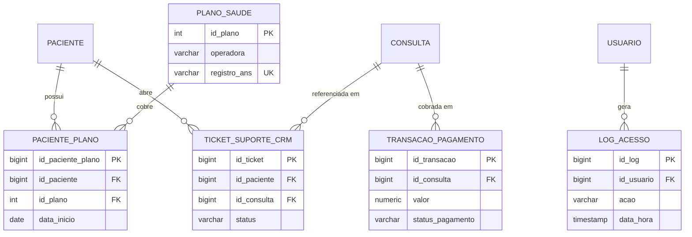

## 2.A Modelagem Lógica OLTP - Entidades Operacionais e de Suporte

Esta seção modela as entidades de **cobertura de saúde, financeiro, suporte ao paciente e auditoria** do modelo operacional (PostgreSQL). Elas complementam o núcleo clínico e de usuários (Parte 1), referenciando-o por chaves estrangeiras.

### 2.A.1 Entidades

| Entidade | Papel no sistema | Depende de (Parte 1) |
|---|---|---|
| `PLANO_SAUDE` | Catálogo de planos/operadoras aceitos | - |
| `PACIENTE_PLANO` | Vínculo entre paciente e plano, com histórico de vigência | `PACIENTE` |
| `TRANSACAO_PAGAMENTO` | Cobrança financeira de uma consulta | `CONSULTA` |
| `TICKET_SUPORTE_CRM` | Chamado de suporte e relacionamento | `PACIENTE`, `CONSULTA` |
| `LOG_ACESSO` | Trilha de auditoria de acessos e ações | `USUARIO` |

### 2.A.2 Dicionário de dados

#### PLANO_SAUDE
| Atributo | Tipo (PostgreSQL) | Restrições | Descrição |
|---|---|---|---|
| id_plano | SERIAL | PK | Identificador do plano |
| operadora | VARCHAR(100) | NOT NULL | Nome da operadora |
| nome_plano | VARCHAR(100) | NOT NULL | Nome comercial do plano |
| tipo_cobertura | VARCHAR(30) | NOT NULL | Ex.: ambulatorial, hospitalar, completo |
| registro_ans | VARCHAR(20) | UNIQUE | Registro na ANS |
| ativo | BOOLEAN | NOT NULL, DEFAULT TRUE | Plano aceito atualmente |

#### PACIENTE_PLANO
| Atributo | Tipo | Restrições | Descrição |
|---|---|---|---|
| id_paciente_plano | BIGSERIAL | PK | Identificador do vínculo |
| id_paciente | BIGINT | FK -> PACIENTE, NOT NULL | Paciente titular |
| id_plano | INT | FK -> PLANO_SAUDE, NOT NULL | Plano contratado |
| numero_carteirinha | VARCHAR(30) | NOT NULL | Número da carteirinha |
| data_inicio | DATE | NOT NULL | Início da vigência |
| data_fim | DATE | NULL | Fim da vigência (NULL = vigente) |

> Restrição única sugerida: (`id_paciente`, `id_plano`, `data_inicio`).

#### TRANSACAO_PAGAMENTO
| Atributo | Tipo | Restrições | Descrição |
|---|---|---|---|
| id_transacao | BIGSERIAL | PK | Identificador da transação |
| id_consulta | BIGINT | FK -> CONSULTA, NOT NULL | Consulta cobrada |
| valor | NUMERIC(10,2) | NOT NULL, CHECK (valor >= 0) | Valor efetivamente cobrado |
| metodo | VARCHAR(20) | NOT NULL, CHECK IN ('PIX','CARTAO_CREDITO','CARTAO_DEBITO','BOLETO','CONVENIO') | Forma de pagamento |
| status_pagamento | VARCHAR(20) | NOT NULL, CHECK IN ('PENDENTE','APROVADO','RECUSADO','ESTORNADO') | Situação |
| data_transacao | TIMESTAMP | NOT NULL, DEFAULT now() | Momento da cobrança |
| codigo_gateway | VARCHAR(60) | NULL | Referência da transação no gateway externo |

> **LGPD/segurança:** dados de cartão **não** são armazenados; guarda-se apenas a referência devolvida pelo gateway de pagamento.

#### TICKET_SUPORTE_CRM
| Atributo | Tipo | Restrições | Descrição |
|---|---|---|---|
| id_ticket | BIGSERIAL | PK | Identificador do chamado |
| id_paciente | BIGINT | FK -> PACIENTE, NOT NULL | Paciente solicitante |
| id_consulta | BIGINT | FK -> CONSULTA, NULL | Consulta relacionada (opcional) |
| categoria | VARCHAR(30) | NOT NULL | Ex.: pagamento, agendamento, acesso, técnico |
| prioridade | VARCHAR(10) | NOT NULL, CHECK IN ('BAIXA','MEDIA','ALTA') | Urgência |
| status | VARCHAR(20) | NOT NULL, CHECK IN ('ABERTO','EM_ATENDIMENTO','RESOLVIDO','FECHADO') | Situação |
| descricao | TEXT | NOT NULL | Relato do problema |
| data_abertura | TIMESTAMP | NOT NULL, DEFAULT now() | Abertura |
| data_fechamento | TIMESTAMP | NULL | Encerramento |

#### LOG_ACESSO
| Atributo | Tipo | Restrições | Descrição |
|---|---|---|---|
| id_log | BIGSERIAL | PK | Identificador do registro |
| id_usuario | BIGINT | FK -> USUARIO, NULL | Usuário (NULL em login com e-mail inexistente) |
| acao | VARCHAR(30) | NOT NULL | Ex.: LOGIN, LOGOUT, LEITURA, ALTERACAO, EXPORTACAO |
| recurso | VARCHAR(50) | NOT NULL | Entidade acessada (ex.: PRONTUARIO) |
| id_registro | BIGINT | NULL | Registro específico acessado |
| resultado | VARCHAR(10) | NOT NULL, CHECK IN ('SUCESSO','FALHA','NEGADO') | Desfecho |
| ip_origem | INET | NOT NULL | IP da requisição |
| data_hora | TIMESTAMP | NOT NULL, DEFAULT now() | Momento do evento |

> O `LOG_ACESSO` sustenta a rastreabilidade exigida pela LGPD para dados sensíveis de saúde. É uma tabela *append-only* (sem UPDATE/DELETE).

### 2.A.3 Diagrama Entidade-Relacionamento 

As entidades `PACIENTE`, `CONSULTA` e `USUARIO` são modeladas na Parte 1 e aparecem aqui apenas como referência.

### 2.A.4 Cardinalidades e regras de negócio

| Relacionamento | Cardinalidade | Regra |
|---|---|---|
| PACIENTE - PLANO_SAUDE | N : N (via PACIENTE_PLANO) | Um paciente pode ter vários planos ao longo do tempo; um plano atende vários pacientes |
| CONSULTA - TRANSACAO_PAGAMENTO | 1 : N | Uma consulta pode ter mais de uma transação (recusa seguida de nova tentativa, estorno) |
| PACIENTE - TICKET_SUPORTE_CRM | 1 : N | Um paciente pode abrir vários chamados |
| CONSULTA - TICKET_SUPORTE_CRM | 1 : N (opcional) | O chamado pode ou não estar ligado a uma consulta |
| USUARIO - LOG_ACESSO | 1 : N | Todo evento auditável referencia o usuário que o gerou |

### 2.A.5 Consistência e integração

- **Sem duplicação:** `CONSULTA.valor` é o **preço da consulta**; `TRANSACAO_PAGAMENTO.valor` é o **valor efetivamente cobrado** em cada tentativa. São grandezas distintas.
- **Sem tabelas desconectadas:** toda entidade desta seção possui FK para o núcleo clínico ou é referenciada por outra (`PLANO_SAUDE` via `PACIENTE_PLANO`).
- **Normalização:** atributos atômicos (1FN) e sem dependências parciais ou transitivas (2FN/3FN). Dados do plano ficam só em `PLANO_SAUDE`.
- **Integração com o DW (OLAP):** `PLANO_SAUDE`/`PACIENTE_PLANO` alimentam `DIM_PACIENTE.plano_saude`; `TRANSACAO_PAGAMENTO` alimenta `valor_consulta` em `FATO_ATENDIMENTO_ANALITICO`.

### 2.A.6 Dependências com a Parte 1 (a confirmar com Hudnei)

- [ ] Existência da entidade `USUARIO` (`id_usuario` BIGINT PK), exigida por `MEDICO.id_usuario` e por `LOG_ACESSO`.
- [ ] Tipos das PKs de `PACIENTE` e `CONSULTA` como `BIGINT`, para as FKs ficarem compatíveis.
- [ ] Decisão sobre vincular `PACIENTE` a `USUARIO` (`id_usuario` nullable), para auditar acessos de pacientes ao portal.
- [ ] Avaliar `CONSULTA.id_paciente_plano` (FK nullable) para registrar atendimentos por convênio.
